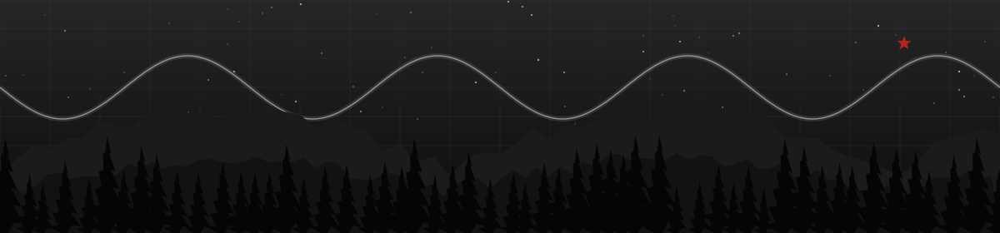
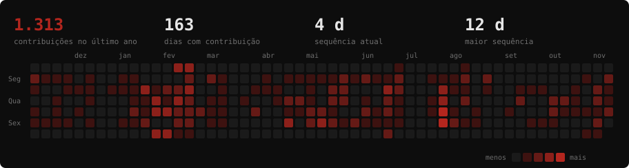
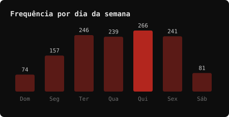
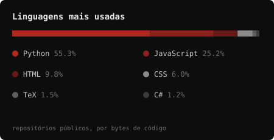

  

  
   
  

  
  
  

### ♟ 1. e4 · quem sou

Oi! Sou o Leandro, de Vitória (ES). Estudo Engenharia Elétrica no IFES (termino em meados de 2027) e cheguei ao software pelo caminho da energia: comecei como estagiário em O&M de usinas solares e hoje escrevo o back end que monitora essas usinas.

Na **Mola Mola** cuido da plataforma que acompanha **45 usinas fotovoltaicas de 7 organizações**, puxando dados de 6 portais diferentes, SCADA locais e APIs de inversores. Boa parte do trabalho é fazer dado ruim, API instável e fuso horário errado virarem uma série temporal confiável.

Fora do código, quase sempre tem metal tocando e, nas pausas, xadrez. Gosto de software livre e de conhecimento compartilhado, por isso meus projetos pessoais ficam públicos aqui.

  

### ♞ 2. Cf3 · o que faço no dia a dia

- ⚡ **APIs e serviços** em Django REST e FastAPI, com Celery para ingestão, reconciliação e backfill de séries temporais em PostgreSQL/TimescaleDB.
- 🔌 **Integrações** com OAuth, retry e fallback para rate limit, indisponibilidade e dado faltando. Parto do princípio de que a API do outro lado vai cair.
- 🐳 **Docker e CI/CD** com GitHub Actions: lint, testes, deploy em staging e produção, rollback e health checks.
- 🧠 **IA em produção**: classificação de alertas de inversores com LightGBM (F1 de 0,94 na detecção de anomalia), separando treino e teste por usina para não vazar dado.

### ♝ 3. Bc4 · projetos

Projetos pessoais com dados fictícios. Os números saem dos testes de cada repositório, então dá para reproduzir.

| Projeto | O que faz | Resultado | Stack |
|---|---|---|---|
| [ChatDesk](https://github.com/TrveLeo/chatdesk) | Atendimento que responde só com o que está nos documentos da empresa, cita a fonte e recusa o que não sabe | 206 testes, 100% de cobertura | FastAPI · pgvector · RAG |
| [ClauseGuard](https://github.com/TrveLeo/clauseguard) | Agente que audita contrato contra a política da empresa e para pedindo revisão humana quando o risco é alto | 93,3% de recall, zero falso positivo no benchmark | LangGraph · Qdrant · FastAPI |
| [LeadDesk](https://github.com/TrveLeo/leaddesk) | CRM de pipeline comercial com prospecção acoplada | 199 testes, 100% de cobertura | FastAPI · SQLAlchemy 2.0 · PostgreSQL |
| [ConciliaFlow](https://github.com/TrveLeo/conciliaflow) | Conciliação automática de planilhas de vendas e créditos, com fila de revisão | 77,2% conciliado sem intervenção, 61 testes | FastAPI · Pandas · PostgreSQL |
| [YOLOv8 + Optuna](https://github.com/TrveLeo/Otimizacao_de_arquitetura_e_hiperparametros_yolov8) | Detecção de armas de fogo em câmeras, buscando arquitetura e hiperparâmetros (pesquisa no IFES, com artigo) | Modelo menor supera o maior em precision e mAP@50 | PyTorch · YOLOv8 · Optuna |
| [Santander](https://github.com/TrveLeo/santander-customer-transaction-prediction) | Classificação binária de transações bancárias (Kaggle) | 0,9181 de AUC-ROC out-of-fold contra 0,8997 do baseline | LightGBM · scikit-learn |

### ♜ 4. O-O · stack

  
  
  
  
  
  
  
  
  
  
    
  

### ♛ 5. d3 · atividade

  

  
  

atualizado todo dia por um GitHub Action deste repositório. Inclui contribuições em repositórios privados.

### ♚ 6. … · vamos conversar

Estou aberto a oportunidades como desenvolvedor back end. Se quiser trocar ideia sobre Python, dados de energia, agentes de IA ou uma partida de xadrez, me chama em **leandrobaldan.contato@gmail.com** ou no [LinkedIn](https://www.linkedin.com/in/leandro-baldan/).

★ conhecimento bom é conhecimento compartilhado

